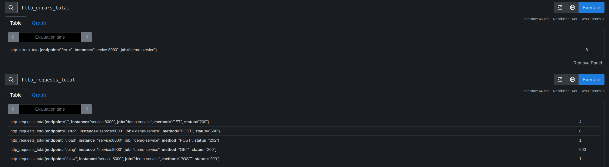
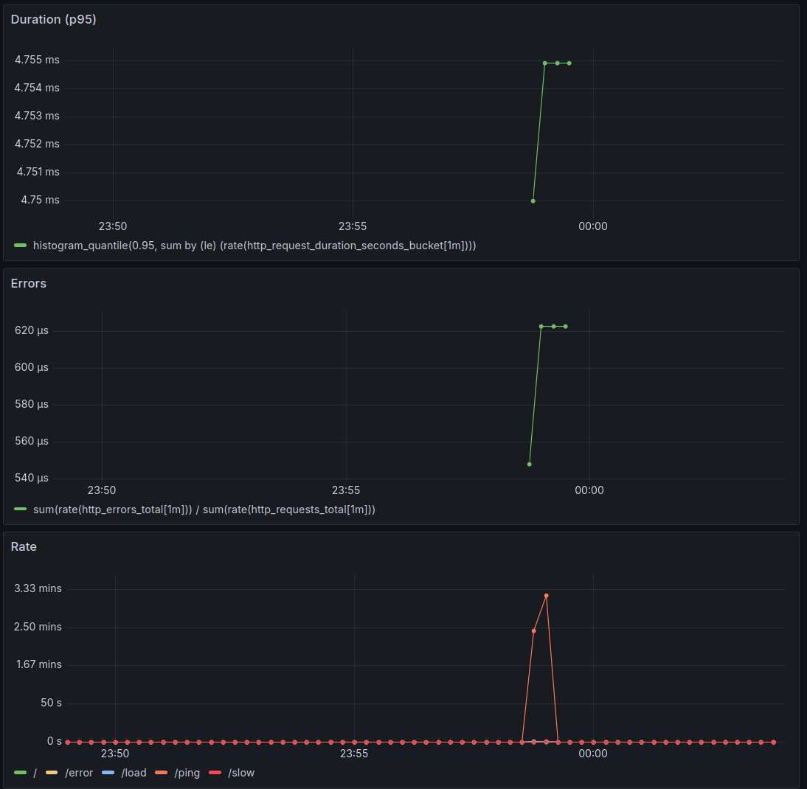
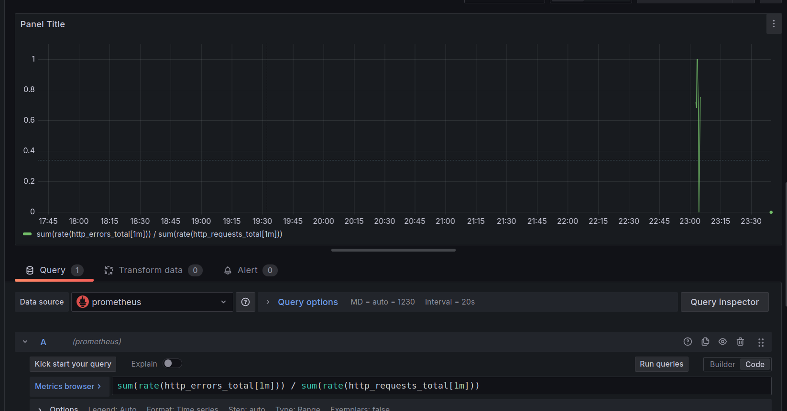
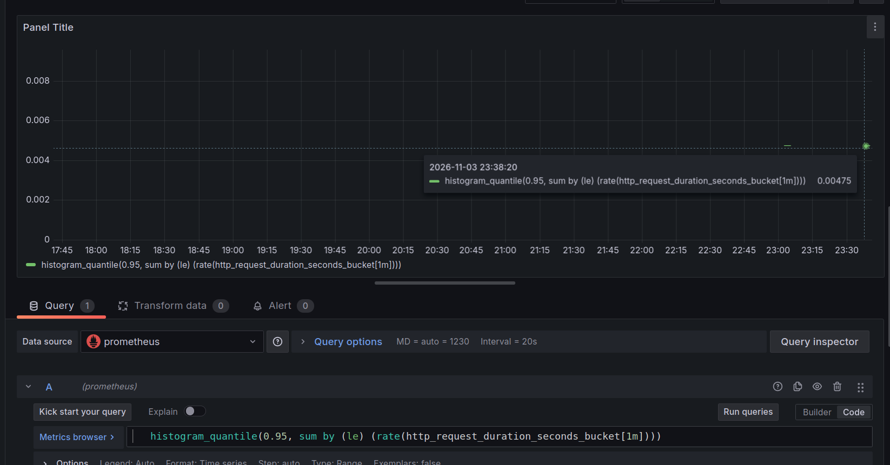
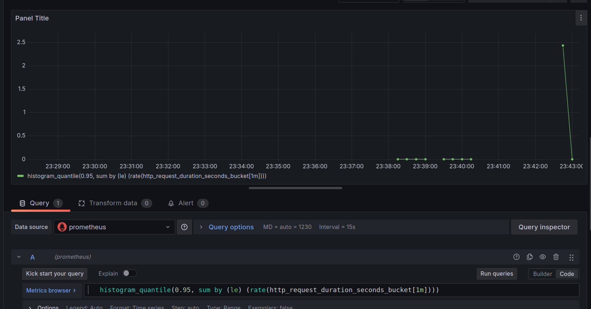
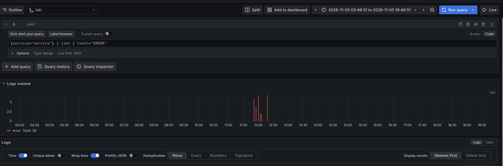
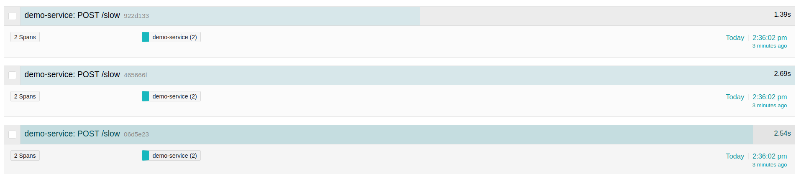
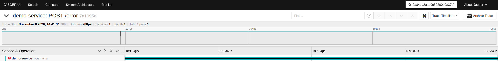
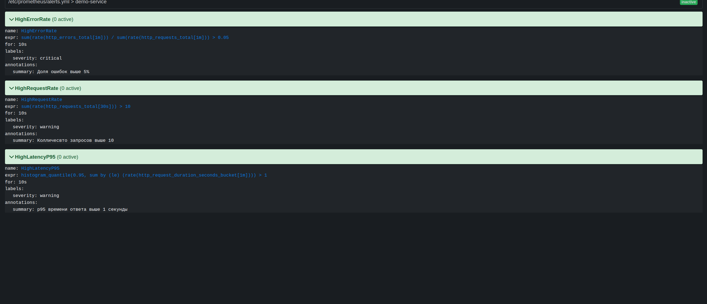
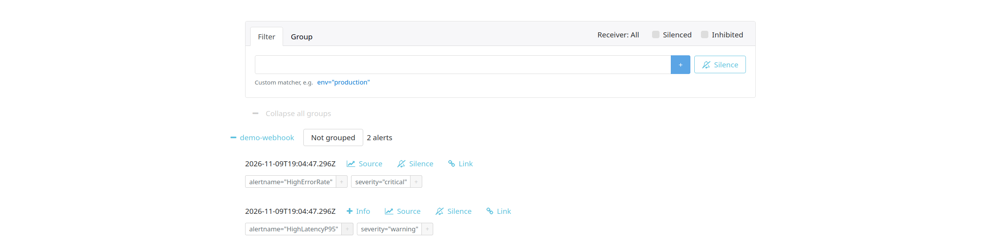

# Лабораторная работа №1. Мониторинг сервиса: метрики, логи, трейсы, алерты

Для запуска:

```bash
docker compose up --build
```

Адреса после запуска:

| Компонент | Адрес |
|---|---|
| Сервис с кнопками | http://localhost:8000 |
| Prometheus | http://localhost:9090 |
| Grafana (admin / admin) | http://localhost:3000 |
| Jaeger UI | http://localhost:16686 |
| Alertmanager | http://localhost:9093 |

## 1. Сервис

Мы использовали небольшой HTTP-сервис на Python (Flask, запускается через gunicorn), у которого есть страница с тремя кнопками. Каждая кнопка вызывает свой эндпоинт, чтобы можно было самим создавать разные ситуации:

- «Создать ошибку» — `POST /error`, возвращает код 500, увеличивает счётчик ошибок и помечает спан как ошибочный;
- «Создать задержку» — `POST /slow`, «спит» от 1 до 3 секунд внутри вложенного спана `slow-dependency`;
- «Нагрузка» — `POST /load`, сервис сам отправляет себе 600 запросов на `/ping`, из-за чего резко растёт интенсивность запросов.

Кроме того, сервис:

- отдаёт метрики в формате Prometheus на `/metrics`;
- пишет логи в stdout одной JSON-строкой с полями `ts`, `level`, `message`, `trace_id`;
- отправляет трейсы по протоколу OTLP (OpenTelemetry) на адрес из переменной `OTEL_EXPORTER_OTLP_ENDPOINT`;
- принимает webhook от Alertmanager на `/alert-webhook` и записывает срабатывание алерта в лог.

Образ собирается из `Dockerfile` (на базе `python:3.12-slim`, зависимости в `requirements.txt`).

## 2. Метрики сервиса

В коде заведены три метрики по методике RED:

| Метрика | Тип | Что считает |
|---|---|---|
| `http_requests_total{method, endpoint, status}` | counter | общее число запросов |
| `http_errors_total{endpoint}` | counter | число ответов 5xx |
| `http_request_duration_seconds{endpoint}` | histogram | время ответа, разложенное по «корзинам» |

Counter только растёт, поэтому по нему нельзя понять, что происходит сейчас: для этого используется функция `rate()`. Histogram позволяет считать перцентили, например p95. Метки (labels) позволяют разделять метрики по адресам, методам и статусам.

## 3. Prometheus

Prometheus сам забирает метрики с сервиса (pull-модель) по расписанию. В `prometheus/prometheus.yml` задано:

```yaml
global:
  scrape_interval: 5s
  evaluation_interval: 5s

rule_files:
- /etc/prometheus/alerts.yml

alerting:
  alertmanagers:
- static_configs:
  - targets: ["alertmanager:9093"]

scrape_configs:
- job_name: demo-service
    metrics_path: /metrics
    static_configs:
- targets: ["service:8000"]
```

- `scrape_interval` — как часто Prometheus забирает метрики, `targets` — откуда;
- `evaluation_interval` — как часто проверяются условия алертов;
- адрес `service:8000`, а не `localhost:8000`: внутри контейнера Prometheus `localhost` — это он сам, а контейнеры в сети docker compose обращаются друг к другу по имени сервиса.

На странице Targets цель `demo-service` в состоянии UP. Когда мы останавливали сервис, состояние менялось на DOWN, а в колонке Error появлялась причина (имя `service` не разрешалось).



## 4. Grafana и дашборд RED

В Grafana подключен источник данных Prometheus (`http://prometheus:9090`, по имени сервиса из compose). Дашборд «Demo service — RED» состоит из трёх панелей:

**Rate** (интенсивность, запросов в секунду):

```promql
sum by (endpoint) (rate(http_requests_total[30s]))
```

**Errors** (доля ошибок):

```promql
sum(rate(http_errors_total[1m])) / sum(rate(http_requests_total[1m]))
```

Здесь `sum` стоит отдельно в числителе и знаменателе: у метрик разные наборы меток, и без этого Prometheus не нашёл бы пары для деления.

**Duration** (p95 времени ответа):

```promql
histogram_quantile(0.95, sum by (le) (rate(http_request_duration_seconds_bucket[1m])))
```

`rate()` нужен, потому что сам счётчик только растёт и по нему не видно, идёт ли нагрузка сейчас. Он показывает скорость роста за окно. p95 = 2,5 секунды означает, что 95% запросов были обработаны за 2,5 секунды или быстрее.

Кнопки на странице сервиса влияют на панели: «Нагрузка» поднимает Rate, «Создать ошибку» — Errors, «Создать задержку» — Duration.



Отдельные панели:





## 5. Логи: Loki и Promtail

Promtail собирает логи контейнеров и отправляет их в Loki, а Loki хранит их и отвечает на запросы Grafana. Конфиг Promtail (`promtail/promtail-config.yml`):

```yaml
server:
  http_listen_port: 9080

positions:
  filename: /tmp/positions.yaml

clients:
- url: http://loki:3100/loki/api/v1/push

scrape_configs:
- job_name: docker
    docker_sd_configs:
- host: unix:///var/run/docker.sock
        refresh_interval: 5s
    relabel_configs:
- source_labels: ["__meta_docker_container_label_com_docker_compose_service"]
        target_label: service
```

- `docker.sock` подключен к контейнеру Promtail, чтобы он мог через Docker находить контейнеры и читать их логи (автообнаружение `docker_sd_configs`);
- из метки compose-сервиса создаётся метка `service`, по ней в Loki ищутся логи;
- адрес `http://loki:3100` — отправка логов в Loki по сети.

Loki подключен к Grafana как второй источник данных. Ошибку, созданную кнопкой, мы нашли в Explore запросом:

```
{service="service"} | json | level="ERROR"
```

`| json` разбирает JSON-строку на поля (`level`, `message`, `trace_id`), а `level="ERROR"` фильтрует по полю `level`.



## 6. Трейсы: OpenTelemetry и Jaeger

Сервис инструментирован OpenTelemetry: `FlaskInstrumentor` автоматически создаёт корневой спан для каждого запроса. В обработчике задержки медленная операция обёрнута во вложенный спан `slow-dependency`, а в обработчике ошибки спан получает статус `ERROR`.

Трейсы отправляются по OTLP (gRPC) в Jaeger. В `docker-compose.yml` для сервиса заданы переменные:

```yaml
environment:
  OTEL_SERVICE_NAME: demo-service
  OTEL_EXPORTER_OTLP_ENDPOINT: http://jaeger:4317
```

В Jaeger (all-in-one) порт 4317 принимает трейсы от сервиса, а порт 16686 — это веб-интерфейс.

- Трейс `POST /slow` содержит два спана: корневой и вложенный `slow-dependency`, который занимает почти всё время;
- трейс `POST /error` содержит один спан с красной отметкой ошибки.

Связь логов и трейсов: в каждой записи лога есть `trace_id`. Мы скопировали его из лога с ошибкой в Grafana, вставили в поле Lookup by Trace ID в Jaeger и открыли тот же трейс. Лог отвечает на вопрос «что произошло», а трейс — «где и сколько времени это заняло».




## 7. Алерты в Alertmanager

Prometheus проверяет правила и решает, что алерт сработал, а Alertmanager принимает алерты и доставляет их получателю. Правила лежат в `prometheus/alerts.yml`:

```yaml
groups:
- name: demo-service
    rules:
- alert: HighErrorRate
        expr: sum(rate(http_errors_total[1m])) / sum(rate(http_requests_total[1m])) > 0.05
        for: 10s
        keep_firing_for: 2m
        labels:
          severity: critical
        annotations:
          summary: "Доля ошибок выше 5%"
- alert: HighRequestRate
        expr: sum(rate(http_requests_total[30s])) > 10
        for: 10s
        keep_firing_for: 2m
        labels:
          severity: warning
        annotations:
          summary: "Всплеск трафика: больше 10 запросов в секунду"
- alert: HighLatencyP95
        expr: histogram_quantile(0.95, sum by (le) (rate(http_request_duration_seconds_bucket[1m]))) > 1
        for: 10s
        keep_firing_for: 2m
        labels:
          severity: warning
        annotations:
          summary: "p95 времени ответа выше 1 секунды"
```

Параметр `for: 10s` означает, что условие должно непрерывно держаться 10 секунд. Пока оно выполняется меньше, алерт в состоянии pending, потом переходит в firing. `keep_firing_for: 2m` добавлен только для демонстрации: алерт остаётся в firing ещё 2 минуты после окончания нагрузки, чтобы успеть сделать скриншоты.

Получатель в `alertmanager/alertmanager.yml` — webhook на сам сервис (`/alert-webhook`), который записывает срабатывание в лог:

```yaml
route:
  receiver: demo-webhook
  group_wait: 5s

receivers:
- name: demo-webhook
    webhook_configs:
- url: http://service:8000/alert-webhook
        send_resolved: true
```

### Обоснование трёх алертов

| Алерт | Что ловит | Чем грозит |
|---|---|---|
| **HighErrorRate** — доля ответов 5xx больше 5% | Ситуацию, когда пользователи реально получают ошибки: сломанный релиз, упавшая зависимость. Строится на **доле**, а не на количестве: 10 ошибок из 10 запросов — авария, а 10 из 10 000 — почти норма, и порог по количеству либо молчал бы при малом трафике, либо срабатывал бы зря при большом | Потерей запросов и выручки, нарушением доступности сервиса |
| **HighRequestRate** — больше 10 запросов в секунду | Всплеск трафика: наплыв пользователей, бот, ретраи клиентов | Исчерпанием ресурсов и каскадной деградацией; ловится раньше, чем вырастут ошибки и задержки. Порог выбран под масштаб лабы, в реальной системе берётся от обычного уровня трафика |
| **HighLatencyP95** — p95 времени ответа больше 1 с | Деградацию скорости при ещё нормальной доле ошибок: медленная база, внешний сервис. Берётся p95, а не среднее, потому что среднее скрывает «хвост» медленных запросов | Таймаутами клиентов и уходом пользователей |

### Срабатывание

Сначала все три правила в состоянии inactive:



Срабатывание вызывалось кнопками и нагрузкой на сервис: «Создать ошибку» подряд — HighErrorRate, «Нагрузка» — HighRequestRate, «Создать задержку» подряд — HighLatencyP95. Алерты сначала переходили в pending, затем в firing:




Заметка: при смешанной нагрузке (множество быстрых запросов `/ping` вперемешку с ошибками) доля ошибок и p95 «разбавляются», и срабатывает только HighRequestRate. Поэтому нагрузку для остальных алертов мы запускали отдельно.

## Возникшие трудности

- **`No module named 'pkg_resources'` при запуске сервиса.** Библиотека автоинструментирования OpenTelemetry использует `pkg_resources` из `setuptools`, а в образе его не было. Решение: добавили `setuptools<81` в `requirements.txt`.
- **`is a directory` у Promtail.** Docker не нашёл файл конфига на хосте и создал на его месте пустую папку. Решение: удалили папку, создали настоящий файл и пересоздали контейнер (`docker compose rm -sf promtail`, затем `up -d`).
- **Пустая страница Alerts в Prometheus.** Правила не были подключены: нужны `rule_files` в `prometheus.yml` и монтирование `alerts.yml` в контейнер.
- **Алерты быстро исчезали.** Это штатное поведение: алерт горит, пока выполняется условие. Для скриншотов добавлен `keep_firing_for`.

## Итог
Для одного сервиса собран полный стек наблюдаемости: метрики (Prometheus + Grafana), логи (Promtail + Loki + Grafana), трейсы (OpenTelemetry + Jaeger) и алерты (Prometheus + Alertmanager). Лабороторная работа дала чутка больше представление о том что предстоит делаь в будущем. И очень понравилась идея с ИИшкой, которая не даёт пройти на следущий этап, пока не ответишь на все вопросы, что дало больше погружения, но итогда вопросы от ИИшки были весьма простыми и очень глупыми, где ответ был в самом впопросе, но итогда приходилось и подумать и поговорить с ИИшкой.
